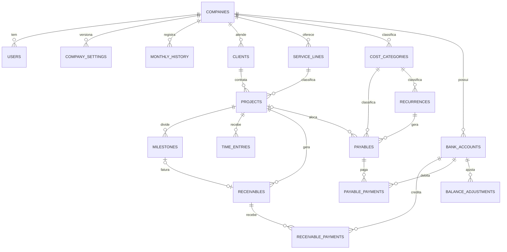
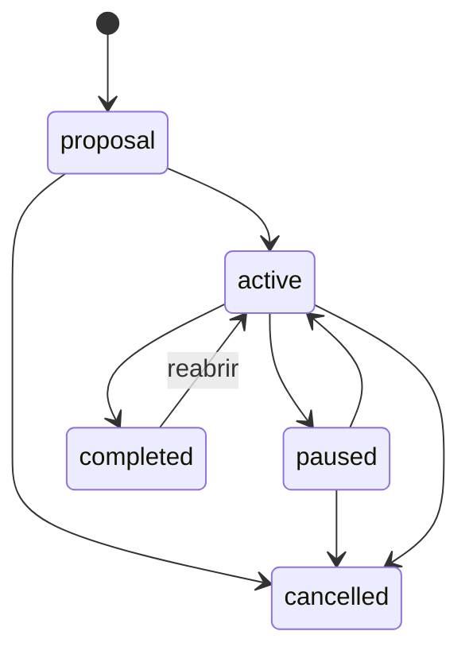
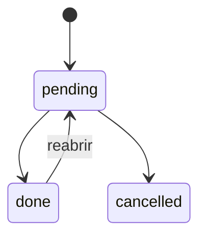
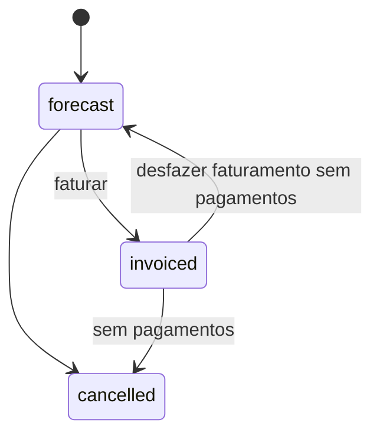

# SPEC — App de gestão da LSF Soluções

Versão 1.0 · Etapa 1 do `PROMPT.md` · aguardando aprovação

Este documento define **o que** o sistema faz e **como calcula**. O **como construir** e a ordem dos marcos ficam no `PLANO.md` (Etapa 2).

---

## 1. Visão geral

App web de usuário único para um consultor solo no Simples Nacional. Responde, em ordem de prioridade:

1. Estou ganhando ou perdendo dinheiro, e onde? (cliente, projeto, linha de serviço)
2. Quanto entra e sai de caixa nos próximos 90 dias?
3. O que preciso entregar, para quem e quando?

### 1.1 Glossário

| Termo | Significado no sistema |
|---|---|
| Competência | Mês ao qual uma receita ou custo pertence. Receita: mês da **data de faturamento** (emissão da nota). Custo: mês informado no lançamento. |
| Caixa | Mês em que o dinheiro efetivamente entrou ou saiu (data do pagamento). |
| Hora de projeto | Hora apontada em um projeto. Conta como hora produtiva. |
| Hora interna | Hora sem projeto: comercial, administrativo, estudo, outro. Não gera receita. |
| Hora faturável | Hora de projeto marcada como cobrável. Só altera a cobrança em projetos **por hora**. |
| RBT12 | Receita bruta acumulada nos 12 meses anteriores ao mês de apuração. |
| Folha12 | Folha de salários dos 12 meses anteriores, incluindo pró-labore bruto. |
| Fator R | Folha12 / RBT12. Se ≥ 28 %, a atividade sai do Anexo V e vai para o Anexo III. |
| Pró-labore bruto | Valor total que sai da empresa por conta do pró-labore. Inclui o INSS retido de 11 % e o IRRF, se houver. |

### 1.2 Decisões já aprovadas

As respostas padrão da lista de dúvidas foram aceitas. Elas viram regra neste documento:

| # | Decisão | Onde aparece |
|---|---|---|
| D1 | O app calcula o Fator R e mostra o pró-labore mínimo para o Anexo III. | §6.4 |
| D2 | O INSS de 11 % sobre o pró-labore é calculado e lançado automaticamente. | RN-PAG-06 |
| D3 | Receita por competência usa a data de faturamento, separada do vencimento. | `receivables` |
| D4 | Toda hora de projeto conta para o valor-hora efetivo. "Faturável" só importa em projetos por hora. | §6.3 |
| D5 | Mensalidade tem franquia opcional de horas. O excesso gera alerta, sem cobrança automática. | RN-PRJ-07 |
| D6 | Projeto de preço fechado exige pelo menos uma parcela a receber. | RN-PRJ-04 |
| D7 | Conta a receber tem campo opcional de retenção na fonte. | `receivables` |
| D8 | Custo-hora tem percentual de provisão configurável, padrão 0 %. | §6.2 |
| D9 | Uma conta bancária no início, modelo preparado para várias. | `bank_accounts` |
| D10 | Login com e-mail e senha. Verificação em duas etapas fica para depois. | §8 |
| D11 | Sem importação de dados. Histórico anterior entra por formulário de meses passados. | `monthly_history` |

### 1.3 Correção em relação à mensagem anterior

Na lista de dúvidas, a fórmula do custo-hora somava **pró-labore + INSS**. Isso conta o INSS duas vezes. O INSS de 11 % é **retido do pró-labore bruto**, não é um custo a mais: a empresa paga o líquido ao sócio e o INSS ao governo, e a soma dos dois é o bruto. No Anexo III e no Anexo V a contribuição patronal já está dentro do DAS. Por isso todas as fórmulas abaixo usam só o **pró-labore bruto**.

### 1.4 Parâmetros ainda não informados

Os valores da seção 2 do prompt não foram preenchidos. Eles **não alteram a estrutura** desta especificação, porque viram configurações editáveis na tela. Os exemplos numéricos deste documento usam valores ilustrativos, marcados como tal. O seed só será escrito depois que esses números forem informados ou confirmados.

---

## 2. Convenções técnicas

| Item | Regra |
|---|---|
| Dinheiro | `NUMERIC(14,2)` no banco, `Decimal` no Python, string no JSON. Nunca float. |
| Percentuais e alíquotas | `NUMERIC(7,4)` como fração. Exemplo: 15,5 % é `0.1550`. |
| Horas | `NUMERIC(6,2)` em horas decimais. |
| Arredondamento | Cálculos internos com precisão total. Arredondamento `ROUND_HALF_UP` para 2 casas apenas no resultado final de cada indicador e em todo valor gravado. |
| Datas | `DATE` para negócio, `TIMESTAMPTZ` para auditoria. "Hoje" é sempre a data em `America/Sao_Paulo`. |
| Mês de competência | `DATE` com dia 1. Exemplo: outubro de 2026 é `2026-10-01`. |
| Nomes | Tabelas, colunas, enums e endpoints em inglês. Interface, mensagens e documentação em português. |
| Exclusão | Soft delete (`deleted_at`) em clientes, projetos, contas a receber e a pagar. Apontamentos e marcos são excluídos de verdade. |
| Auditoria | Toda tabela tem `created_at` e `updated_at`. Tabelas de negócio têm `created_by` (usuário). |
| Multiempresa | Toda tabela de negócio tem `company_id`. Hoje existe uma única empresa. Toda consulta filtra por ela. |

---

## 3. Modelo de dados

### 3.1 Diagrama



### 3.2 Tabelas

Colunas comuns omitidas abaixo: `id BIGINT PK`, `company_id FK` (exceto em `companies` e `simples_brackets`), `created_at`, `updated_at`.

#### `companies`
| Coluna | Tipo | Regra |
|---|---|---|
| legal_name | VARCHAR(200) | obrigatório |
| trade_name | VARCHAR(200) | |
| cnpj | CHAR(14) | só dígitos, validado |
| city, state | VARCHAR(100), CHAR(2) | |

#### `users`
| Coluna | Tipo | Regra |
|---|---|---|
| email | VARCHAR(254) | único, minúsculo |
| password_hash | VARCHAR(255) | argon2id |
| name | VARCHAR(120) | |
| is_active | BOOLEAN | padrão true |
| last_login_at | TIMESTAMPTZ | |
| failed_logins, locked_until | INT, TIMESTAMPTZ | bloqueio por tentativas |

#### `company_settings` (versionada)
Cada alteração cria uma linha nova com `valid_from`. O cálculo de um mês usa a versão vigente no **último dia** daquele mês. Assim, mudar a meta hoje não reescreve meses passados.

| Coluna | Tipo | Regra |
|---|---|---|
| valid_from | DATE | único por empresa |
| pro_labore_target_gross | NUMERIC(14,2) | pró-labore bruto desejado |
| capacity_hours | NUMERIC(6,2) | horas totais disponíveis no mês |
| billable_hours_target | NUMERIC(6,2) | meta de horas de projeto no mês; > 0 |
| provision_rate | NUMERIC(7,4) | padrão 0 |
| tax_rate_mode | ENUM `manual`, `table` | padrão `manual` |
| manual_tax_rate | NUMERIC(7,4) | obrigatório se modo manual |
| simples_annex_mode | ENUM `fator_r`, `III`, `V` | padrão `fator_r` |
| inss_rate | NUMERIC(7,4) | padrão 0.1100 |
| inss_ceiling | NUMERIC(14,2) | teto do INSS vigente, editável |
| pro_labore_irrf | NUMERIC(14,2) | IRRF mensal fixo, padrão 0 |
| pro_labore_pay_day | SMALLINT | dia do pagamento do pró-labore, padrão 5 |
| revenue_regime | ENUM `accrual`, `cash` | regime do PGDAS; padrão `accrual` |
| cash_alert_floor | NUMERIC(14,2) | saldo mínimo para alerta, padrão 0 |

#### `monthly_history`
Meses anteriores ao uso do app, para RBT12 e Folha12. Para meses com dados no app, o app ignora esta tabela.

| Coluna | Tipo | Regra |
|---|---|---|
| month | DATE | dia 1; único por empresa |
| gross_revenue | NUMERIC(14,2) | ≥ 0 |
| payroll | NUMERIC(14,2) | pró-labore bruto + salários do mês; ≥ 0 |

#### `simples_brackets`
Tabela oficial, versionada. Carregada por migration com os valores da §6.4.

| Coluna | Tipo | Regra |
|---|---|---|
| annex | ENUM `III`, `V` | |
| bracket | SMALLINT | 1 a 6 |
| rbt12_upper | NUMERIC(14,2) | limite superior da faixa |
| nominal_rate | NUMERIC(7,4) | |
| deduction | NUMERIC(14,2) | parcela a deduzir |
| valid_from | DATE | |

#### `clients`
| Coluna | Tipo | Regra |
|---|---|---|
| legal_name | VARCHAR(200) | obrigatório |
| trade_name | VARCHAR(200) | |
| cnpj | CHAR(14) | opcional; se informado, dígitos validados e único por empresa |
| contact_name, email, phone | VARCHAR | |
| city, state | VARCHAR(100), CHAR(2) | |
| status | ENUM `prospect`, `active`, `inactive` | padrão `prospect` |
| notes | TEXT | |
| deleted_at | TIMESTAMPTZ | |

#### `service_lines`
| Coluna | Tipo | Regra |
|---|---|---|
| name | VARCHAR(80) | único por empresa |
| color | CHAR(7) | hex |
| is_active | BOOLEAN | |

Seed fixo: Gestão de Processos, Desenvolvimento de Software, Análise e Engenharia de Dados.

#### `projects`
| Coluna | Tipo | Regra |
|---|---|---|
| client_id | FK clients | obrigatório |
| service_line_id | FK service_lines | obrigatório |
| name | VARCHAR(200) | |
| description | TEXT | |
| billing_model | ENUM `fixed_price`, `subscription`, `hourly` | |
| contract_amount | NUMERIC(14,2) | obrigatório se `fixed_price` |
| monthly_fee | NUMERIC(14,2) | obrigatório se `subscription` |
| hourly_rate | NUMERIC(14,2) | obrigatório se `hourly` |
| subscription_due_day | SMALLINT | 1–28, obrigatório se `subscription` |
| estimated_hours | NUMERIC(6,2) | opcional; total para `fixed_price` e `hourly` |
| monthly_hours_allowance | NUMERIC(6,2) | franquia mensal, só `subscription` |
| start_date | DATE | obrigatório |
| planned_end_date | DATE | ≥ start_date |
| actual_end_date | DATE | obrigatório ao concluir |
| status | ENUM `proposal`, `active`, `paused`, `completed`, `cancelled` | |
| deleted_at | TIMESTAMPTZ | |

`CHECK` no banco garante que só o campo de valor do modelo escolhido está preenchido.

#### `milestones`
| Coluna | Tipo | Regra |
|---|---|---|
| project_id | FK projects | |
| name | VARCHAR(200) | |
| planned_date | DATE | |
| actual_date | DATE | obrigatório se `done` |
| amount | NUMERIC(14,2) | opcional; > 0 se informado |
| status | ENUM `pending`, `done`, `cancelled` | |
| sort_order | SMALLINT | |

#### `time_entries`
| Coluna | Tipo | Regra |
|---|---|---|
| user_id | FK users | |
| entry_date | DATE | não pode ser futura |
| project_id | FK projects | nulo para hora interna |
| internal_category | ENUM `sales`, `admin`, `study`, `other` | nulo para hora de projeto |
| hours | NUMERIC(6,2) | > 0 e ≤ 24 |
| description | VARCHAR(500) | |
| billable | BOOLEAN | padrão true em projeto; sempre false em hora interna |
| billed_receivable_id | FK receivables | preenchido ao fechar período de projeto por hora |

`CHECK`: exatamente um entre `project_id` e `internal_category` é não nulo.

#### `active_timers`
Um cronômetro por usuário. Opcional no MVP.

| Coluna | Tipo |
|---|---|
| user_id | PK, FK users |
| project_id / internal_category | igual a `time_entries` |
| started_at | TIMESTAMPTZ |
| description | VARCHAR(500) |

#### `bank_accounts`
| Coluna | Tipo | Regra |
|---|---|---|
| name | VARCHAR(80) | |
| opening_balance | NUMERIC(14,2) | pode ser negativo |
| opening_date | DATE | |
| is_active | BOOLEAN | |

#### `balance_adjustments`
| Coluna | Tipo | Regra |
|---|---|---|
| bank_account_id | FK | |
| adjustment_date | DATE | |
| amount | NUMERIC(14,2) | positivo ou negativo, ≠ 0 |
| reason | VARCHAR(300) | obrigatório |

#### `cost_categories`
| Coluna | Tipo | Regra |
|---|---|---|
| name | VARCHAR(80) | |
| kind | ENUM `fixed`, `variable`, `owner_pay`, `tax` | |
| system_code | ENUM `DAS`, `INSS_PRO_LABORE`, `PRO_LABORE`, nulo | categorias do sistema não podem ser excluídas |

Seed: Infraestrutura (fixed), Software (fixed), Contador (fixed), Telefone e internet (fixed), Comercial (variable), Serviços de terceiros (variable), Pró-labore (owner_pay, `PRO_LABORE`), INSS sobre pró-labore (owner_pay, `INSS_PRO_LABORE`), DAS (tax, `DAS`).

#### `recurrences`
| Coluna | Tipo | Regra |
|---|---|---|
| category_id | FK | |
| project_id | FK | opcional |
| description | VARCHAR(200) | |
| amount | NUMERIC(14,2) | > 0 |
| day_of_month | SMALLINT | 1–31; meses curtos usam o último dia |
| start_month | DATE | dia 1 |
| end_month | DATE | opcional, dia 1 |
| is_active | BOOLEAN | |

#### `receivables`
| Coluna | Tipo | Regra |
|---|---|---|
| client_id | FK | opcional no marco 1; obrigatório se houver projeto |
| project_id | FK | opcional |
| milestone_id | FK | opcional, único |
| source | ENUM `manual`, `milestone`, `subscription`, `hourly_close`, `fixed_installment` | |
| description | VARCHAR(200) | |
| amount | NUMERIC(14,2) | valor bruto da nota; > 0 |
| withheld_amount | NUMERIC(14,2) | retenção na fonte; padrão 0; < amount |
| invoice_date | DATE | data de faturamento; define a competência; nulo enquanto previsto |
| expected_invoice_date | DATE | competência prevista, usada na projeção enquanto `invoice_date` é nulo |
| due_date | DATE | vencimento |
| status | ENUM `forecast`, `invoiced`, `cancelled` | estado gravado; ver §4.4 |
| reserved_invoice_ref | VARCHAR(60) | reservado para NFS-e futura |
| deleted_at | TIMESTAMPTZ | |

#### `receivable_payments`
| Coluna | Tipo | Regra |
|---|---|---|
| receivable_id | FK | |
| bank_account_id | FK | |
| paid_date | DATE | não futura |
| amount | NUMERIC(14,2) | > 0 |

#### `payables`
| Coluna | Tipo | Regra |
|---|---|---|
| category_id | FK | |
| project_id | FK | opcional; só faz sentido em `variable` |
| recurrence_id | FK | preenchido quando gerado por recorrência |
| source | ENUM `manual`, `recurrence`, `das`, `inss`, `pro_labore` | |
| description | VARCHAR(200) | |
| amount | NUMERIC(14,2) | > 0 |
| competence_month | DATE | dia 1 |
| due_date | DATE | |
| is_estimate | BOOLEAN | true para DAS e INSS enquanto recalculáveis |
| status | ENUM `open`, `cancelled` | estado gravado; ver §4.5 |
| deleted_at | TIMESTAMPTZ | |

Índice único parcial: `(company_id, recurrence_id, competence_month)` onde `recurrence_id` não é nulo. Índice único parcial: `(company_id, source, competence_month)` para `das` e `inss`. Isso torna a geração automática idempotente.

#### `payable_payments`
Igual a `receivable_payments`, ligada a `payables`.

### 3.3 Preparação para o que está fora do MVP

| Funcionalidade futura | O que já fica pronto |
|---|---|
| Multiempresa e portal do cliente | `company_id` em tudo; `users` separado; nada global além de `simples_brackets`. |
| NFS-e | `receivables.reserved_invoice_ref` e `invoice_date`. A nota vira uma tabela própria ligada à conta a receber. |
| Integração bancária e OFX | Pagamentos já são registros separados com conta bancária. A conciliação liga extrato a `*_payments`. |
| Propostas e CRM | Status `prospect` em clientes e `proposal` em projetos. |

---

## 4. Máquinas de estado

### 4.1 Projeto

- Concluir exige `actual_end_date`.
- Cancelar cancela os recebíveis **previstos** do projeto. Recebíveis faturados continuam.
- Reabrir limpa `actual_end_date`.

### 4.2 Marco


### 4.3 Recebível — estado gravado


### 4.4 Recebível — status exibido (calculado, nunca gravado)

`recebido_total = Σ pagamentos`, `liquido = amount − withheld_amount`, `em_aberto = liquido − recebido_total`.

| Ordem | Condição | Status exibido |
|---|---|---|
| 1 | status = `cancelled` | Cancelado |
| 2 | em_aberto ≤ 0 | Recebido |
| 3 | due_date < hoje | Atrasado |
| 4 | recebido_total > 0 | Parcial |
| 5 | status = `invoiced` | Faturado |
| 6 | demais | Previsto |

Um recebível parcial e vencido aparece como **Atrasado**, com o valor em aberto.

### 4.5 Conta a pagar — status exibido

`pago_total = Σ pagamentos`, `em_aberto = amount − pago_total`.

| Ordem | Condição | Status exibido |
|---|---|---|
| 1 | status = `cancelled` | Cancelado |
| 2 | em_aberto ≤ 0 | Pago |
| 3 | due_date < hoje | Atrasado |
| 4 | pago_total > 0 | Parcial |
| 5 | demais | Previsto |

---

## 5. Regras de negócio

Cada regra é uma frase testável. O código de teste referencia o identificador.

### 5.1 Clientes e projetos

- **RN-CLI-01** Quando um CNPJ é informado, então os dígitos verificadores são validados e a gravação é recusada se forem inválidos.
- **RN-CLI-02** Quando um cliente tem projeto `active` ou `paused`, então ele não pode ser marcado `inactive` nem excluído.
- **RN-CLI-03** Quando um projeto passa para `active` e o cliente é `prospect`, então o cliente passa para `active`.
- **RN-PRJ-01** Quando o modelo é `fixed_price`, então `contract_amount` é obrigatório e `monthly_fee` e `hourly_rate` devem ser nulos. Equivalente para os outros modelos.
- **RN-PRJ-02** Quando um projeto `subscription` é ativado, então o sistema gera um recebível por mês, de `start_date` até `planned_end_date`, ou até 12 meses à frente se não houver fim. A geração roda de novo todo dia para manter 12 meses à frente.
- **RN-PRJ-03** Quando a mensalidade termina no meio de um mês, então a última parcela é **integral**. Rateio por dias fica fora do MVP.
- **RN-PRJ-04** Quando um projeto `fixed_price` é ativado, então a soma dos marcos com valor mais os recebíveis de parcela (`fixed_installment`) precisa ser igual a `contract_amount`. Se não houver nenhum, a ativação é recusada.
- **RN-PRJ-05** Quando `contract_amount` e a soma das parcelas divergem, então o projeto mostra a diferença e um aviso. A ativação é bloqueada, a edição posterior não.
- **RN-PRJ-06** Quando um projeto é `cancelled`, então seus recebíveis `forecast` passam para `cancelled`.
- **RN-PRJ-07** Quando as horas de um mês num projeto `subscription` passam da franquia, então surge o alerta de excesso. Nenhum recebível é criado.
- **RN-MIL-01** Quando um marco com valor é concluído, então o sistema cria ou atualiza um recebível `milestone` com `expected_invoice_date` = data real e vencimento = data real + prazo padrão de 15 dias, editável.
- **RN-MIL-02** Quando um marco é reaberto e seu recebível não tem pagamentos, então o recebível é cancelado. Se tiver pagamentos, a reabertura é recusada.
- **RN-MIL-03** Quando um projeto `fixed_price` é criado com marcos com valor, então um recebível `forecast` é criado para cada marco já na criação, usando a data prevista. Concluir o marco só confirma as datas. É isso que faz o fluxo projetado enxergar os marcos futuros.

### 5.2 Apontamento de horas

- **RN-HOR-01** O campo de horas aceita `1,5`, `1.5`, `1:30`, `1h30`, `1h`, `90min` e `90m`. Todos viram `1.50`. Minutos viram fração arredondada para 2 casas: `1:20` vira `1.33`.
- **RN-HOR-02** Quando o valor é ≤ 0, > 24 ou não reconhecido, então a gravação é recusada com mensagem clara.
- **RN-HOR-03** Quando o total do dia passa de 24 h, então a gravação é recusada.
- **RN-HOR-04** Quando a hora é interna, então `billable` é sempre false.
- **RN-HOR-05** O formulário abre com o último projeto usado e a data de hoje.
- **RN-HOR-06** Quando um apontamento está ligado a um recebível de fechamento de período (`billed_receivable_id`), então ele não pode ser alterado nem excluído até o recebível ser cancelado.
- **RN-HOR-07** Quando se fecha um período de um projeto `hourly`, então o sistema soma as horas faturáveis ainda não cobradas até a data de corte, cria um recebível com `amount = horas × hourly_rate` e marca os apontamentos.
- **RN-HOR-08** Quando o cronômetro é parado, então um apontamento é criado com a duração arredondada para cima em múltiplos de 0,05 h (3 min).

### 5.3 Contas a receber

- **RN-REC-01** Faturar exige `invoice_date`. Quando se fatura, `status` vira `invoiced`.
- **RN-REC-02** Quando a soma dos pagamentos passaria do valor líquido, então o pagamento é recusado.
- **RN-REC-03** Quando um recebível tem pagamentos, então ele não pode ser cancelado nem ter o valor reduzido abaixo do total recebido mais a retenção.
- **RN-REC-04** A competência é o mês de `invoice_date`. Enquanto não faturado, a competência prevista é o mês de `expected_invoice_date`.
- **RN-REC-05** "Atrasado" nunca é gravado. É calculado na leitura conforme §4.4.

### 5.4 Contas a pagar e geração automática

- **RN-PAG-01** Uma recorrência gera um lançamento por mês de `start_month` até `end_month`, materializado até **hoje + 90 dias**. A geração é idempotente pelo índice único.
- **RN-PAG-02** Quando o dia da recorrência não existe no mês, então o vencimento é o último dia do mês.
- **RN-PAG-03** Quando uma recorrência muda de valor, então só os lançamentos **futuros e sem pagamento** são atualizados.
- **RN-PAG-04** Quando uma recorrência é desativada ou ganha `end_month`, então os lançamentos futuros sem pagamento são cancelados.
- **RN-PAG-05** O pró-labore é uma recorrência especial (`PRO_LABORE`). O valor informado é o **bruto**. A cada mês ela gera dois lançamentos:
  - Pró-labore líquido = bruto − INSS − IRRF, vencendo no dia `pro_labore_pay_day` do mês.
  - INSS sobre pró-labore, conforme RN-PAG-06.
- **RN-PAG-06** INSS = `min(bruto, inss_ceiling) × inss_rate`, arredondado. Vence no dia 20 do mês seguinte. Competência é o mês do pró-labore. Categoria `INSS_PRO_LABORE`.
- **RN-PAG-07** O IRRF do pró-labore, quando configurado, é lançado na mesma data do INSS, categoria `owner_pay`. O app não calcula a tabela do IR no MVP.
- **RN-PAG-08** Quando o pró-labore bruto é menor que o salário mínimo vigente, então a tela mostra aviso. O salário mínimo é parâmetro editável.

### 5.5 DAS

- **RN-DAS-01** Para cada mês de competência com receita prevista ou faturada, existe um lançamento `das` com `amount = receita_base(m) × alíquota(m)`, arredondado.
- **RN-DAS-02** `receita_base(m)` segue `revenue_regime`. Em `accrual`, soma o valor bruto dos recebíveis não cancelados com competência em m. Em `cash`, soma cada pagamento recebido em m convertido para o bruto: `pagamento × amount / (amount − withheld_amount)`.
- **RN-DAS-03** O vencimento é o dia 20 do mês seguinte à competência. O MVP não ajusta para dia útil.
- **RN-DAS-04** Enquanto o DAS não tem pagamento, ele é recalculado sempre que a receita do mês ou a alíquota mudam. Depois de pago, não muda mais.
- **RN-DAS-05** Quando a receita do mês é zero, então não há lançamento de DAS. Se existia um sem pagamento, ele é cancelado.
- **RN-DAS-06** A tela mostra que o valor é **estimativa** e não substitui o PGDAS.
- **RN-DAS-07** A alíquota segue `tax_rate_mode`. Em `manual`, usa `manual_tax_rate`. Em `table`, usa a fórmula da §6.4.

### 5.6 Caixa

- **RN-CXA-01** Saldo atual de uma conta = `opening_balance` + recebimentos − pagamentos + ajustes, todos com data entre `opening_date` e hoje.
- **RN-CXA-02** Pagamentos e recebimentos com data anterior a `opening_date` não entram no saldo.
- **RN-CXA-03** O fluxo projetado segue a §6.6.

---

## 6. Indicadores e fórmulas

Notação para um mês **m**:

| Símbolo | Definição |
|---|---|
| R(m) | Receita bruta por competência: Σ `amount` de recebíveis não cancelados com competência em m. Recebíveis previstos entram com a competência prevista. |
| Rc(m) | Receita de caixa: Σ pagamentos recebidos com data em m. |
| CF(m) | Custos fixos: Σ `amount` de contas a pagar não canceladas, categoria `fixed`, competência m. |
| CV(m) | Custos variáveis: idem, categoria `variable`. |
| PL(m) | Pró-labore realizado: idem, categoria `owner_pay`. É o bruto: líquido + INSS + IRRF. |
| T(m) | Impostos: idem, categoria `tax`. É o DAS. |
| PLd | Pró-labore bruto desejado, das configurações. |
| Hm | Meta de horas de projeto no mês. |
| Hp(m) | Horas de projeto apontadas em m. |
| Hi(m) | Horas internas apontadas em m. |
| a(m) | Alíquota efetiva do DAS em m. |
| p | Percentual de provisão. |
| v | Peso dos custos variáveis: Σ CV / Σ R dos 3 meses anteriores; 0 se não houver receita. |

Valores do exemplo, **ilustrativos**: CF = 1.200,00 · PLd = 3.000,00 · p = 0 · Hm = 100 · a = 15,5 % (Anexo V, faixa 1) · R = 4.500,00 · CV = 90,00 · Hp = 60 · Hi = 40 · v = 2 %.

### 6.1 Resultado do mês

| Linha | Competência | Caixa |
|---|---|---|
| Receita | R(m) | Rc(m) |
| (−) Impostos | T(m) | DAS pago em m |
| (−) Custos variáveis | CV(m) | pagos em m, categoria `variable` |
| (−) Custos fixos | CF(m) | pagos em m, categoria `fixed` |
| (−) Pró-labore | PL(m) | pagos em m, categoria `owner_pay` |
| **= Resultado** | soma | soma |

A linha de receita separa o que já foi faturado do que ainda está previsto. Num mês já encerrado, o previsto aparece como pendência de faturamento.

Exemplo, competência: 4.500,00 − 697,50 − 90,00 − 1.200,00 − 3.000,00 = **−487,50** (prejuízo).

### 6.2 Custo-hora e preço-hora mínimo

**Custo-hora meta**: quanto custa cada hora de projeto se eu atingir a meta de horas.
```
custo_hora_meta(m) = (CF(m) + PLd) × (1 + p) / Hm
```
Exemplo: (1.200 + 3.000) × 1 / 100 = **42,00**.

**Preço-hora mínimo**: o menor valor por hora que paga o custo e o DAS embutido no preço. É a régua de todos os semáforos.
```
preco_hora_min(m) = custo_hora_meta(m) / (1 − a(m))
```
Exemplo: 42,00 / 0,845 = **49,70**.

**Custo-hora realizado**: quanto custou cada hora de projeto que de fato aconteceu.
```
custo_hora_real(m) = (CF(m) + PLd × (1 + p) + T(m)) / Hp(m)
```
Exemplo: (1.200 + 3.000 + 697,50) / 60 = **81,63**.

Se Hp(m) = 0, o indicador mostra "sem horas no mês". Nunca divide por zero.

Se Hm não estiver configurado, custo-hora meta e preço mínimo mostram "configure a meta de horas".

### 6.3 Rentabilidade por projeto

Para um projeto **P** num período (padrão: desde o início do projeto):

| Símbolo | Definição |
|---|---|
| H(P) | Horas de projeto apontadas em P no período, faturáveis ou não. |
| Rf(P) | Receita faturada: Σ `amount` de recebíveis de P com status `invoiced` e competência no período. |
| Rr(P) | Receita recebida: Σ pagamentos de recebíveis de P no período. |
| CV(P) | Custos variáveis lançados com `project_id` = P no período. |

**Valor-hora efetivo realizado**:
```
vhe_real(P) = Rf(P) / H(P)
```
O tooltip mostra também `Rr(P) / H(P)`.

**Valor-hora efetivo projetado** (só para projetos em andamento):

| Modelo | Fórmula |
|---|---|
| `fixed_price` | contract_amount / max(H(P), estimated_hours) |
| `subscription` | Σ mensalidades do período / H(P) |
| `hourly` | hourly_rate × horas faturáveis / H(P) |

No preço fechado, o valor projetado cai conforme as horas passam da estimativa. Esse é o sinal de estouro.

**Margem**:
```
margem(P) = Rf(P) × (1 − a) − CV(P) − H(P) × custo_hora_meta
```
A alíquota e o custo-hora usados são os do mês de cada lançamento.

**Semáforo**, comparando `vhe_real(P)` com `preco_hora_min`:

| Faixa | Cor |
|---|---|
| ≥ 100 % | verde |
| 80 % a 99,99 % | amarelo |
| < 80 % | vermelho |
| sem horas | cinza, "sem horas apontadas" |

**Consumo de horas**:
```
consumo(P) = H(P) / estimated_hours
```
Mostra "sem estimativa" quando `estimated_hours` é nulo ou zero. Em `subscription`, o consumo é mensal contra `monthly_hours_allowance`.

Exemplo, projeto de app em preço fechado: contrato 9.000,00, estimativa 80 h, apontadas 70 h, faturado 4.500,00.
- vhe_real = 4.500 / 70 = 64,29, que é 129 % do preço mínimo de 49,70: **verde**.
- vhe_projetado = 9.000 / max(70, 80) = 112,50.
- consumo = 70 / 80 = 87,5 %: **alerta de estouro**.
- margem = 4.500 × 0,845 − 0 − 70 × 42,00 = 3.802,50 − 2.940,00 = **862,50**.

### 6.4 Simples Nacional: alíquota, faixa e Fator R

**RBT12** do mês m = soma da receita bruta dos 12 meses anteriores a m. Para cada mês, usa R do app se houver dados, senão `monthly_history`.

Se a empresa tem menos de 12 meses de atividade, `RBT12 = (soma dos meses existentes / nº de meses) × 12`. No primeiro mês de atividade, `RBT12 = R(m) × 12`. Essa é a proporcionalização da Lei Complementar 123.

**Alíquota efetiva**:
```
a(m) = (RBT12 × aliquota_nominal − parcela_deduzir) / RBT12
```
Se RBT12 = 0, usa a alíquota nominal da faixa 1.

**Fator R**:
```
fator_r(m) = Folha12 / RBT12
```
Folha12 = Σ PL(m) dos 12 meses anteriores (do app, senão `monthly_history.payroll`), com a mesma proporcionalização. Se RBT12 = 0, o Fator R usa a folha e a receita do próprio mês. Se as duas forem zero, vale o Anexo V.

| simples_annex_mode | Anexo usado |
|---|---|
| `fator_r` | III se fator_r ≥ 0,28; senão V |
| `III` | III |
| `V` | V |

**Pró-labore mínimo para o Anexo III**, exibido no painel:
```
pl_min_III = 0,28 × RBT12 / 12
```
Exemplo: com RBT12 = 54.000,00 o mínimo é **1.260,00** por mês. Com Folha12 zerada, a empresa fica no Anexo V a 15,5 %. Com pró-labore de 1.260,00 por 12 meses, cai para o Anexo III a 6 %. Sobre 4.500,00 de receita, a diferença é de **427,50 por mês** de DAS. A tela mostra essa simulação.

**Tabelas carregadas na migration** (vigentes desde 2018, conferir com o contador):

Anexo III
| Faixa | RBT12 até | Alíquota nominal | Parcela a deduzir |
|---|---|---|---|
| 1 | 180.000,00 | 6,00 % | 0,00 |
| 2 | 360.000,00 | 11,20 % | 9.360,00 |
| 3 | 720.000,00 | 13,50 % | 17.640,00 |
| 4 | 1.800.000,00 | 16,00 % | 35.640,00 |
| 5 | 3.600.000,00 | 21,00 % | 125.640,00 |
| 6 | 4.800.000,00 | 33,00 % | 648.000,00 |

Anexo V
| Faixa | RBT12 até | Alíquota nominal | Parcela a deduzir |
|---|---|---|---|
| 1 | 180.000,00 | 15,50 % | 0,00 |
| 2 | 360.000,00 | 18,00 % | 4.500,00 |
| 3 | 720.000,00 | 19,50 % | 9.900,00 |
| 4 | 1.800.000,00 | 20,50 % | 17.100,00 |
| 5 | 3.600.000,00 | 23,00 % | 62.100,00 |
| 6 | 4.800.000,00 | 30,50 % | 540.000,00 |

Limitações assumidas: um anexo para a empresa inteira; sem sublimite de ISS; sem segregação de receitas por CNAE.

### 6.5 Ponto de equilíbrio

```
pe_receita(m) = (CF(m) + PLd × (1 + p)) / (1 − a(m) − v)
pe_horas(m)   = pe_receita(m) / vhe_medio
```
`vhe_medio` = Σ R / Σ Hp dos 3 meses anteriores. Sem horas, `pe_horas` mostra "sem histórico".

Exemplo: 4.200 / (1 − 0,155 − 0,02) = **5.090,91** por mês. Com vhe_medio de 75,00, são **67,9 h** de projeto. A receita atual de 4.500,00 está **590,91 abaixo** do equilíbrio.

### 6.6 Fluxo de caixa projetado (90 dias)

Para cada dia d de hoje até hoje + 90:
```
saldo(d) = saldo_atual
         + Σ em_aberto de recebíveis com vencimento entre amanhã e d
         − Σ em_aberto de contas a pagar com vencimento entre amanhã e d
         − Σ em_aberto de contas a pagar já vencidas
```

| Caso | Tratamento |
|---|---|
| Recebível vencido não recebido | **Fora** da projeção. Aparece em linha separada "atrasados a receber". Critério conservador. |
| Conta a pagar vencida não paga | Entra **hoje**. |
| Recebível parcial | Entra só o valor em aberto. |
| DAS de meses futuros | Gerado a partir da receita prevista daquele mês (RN-DAS-01). |
| Recorrências | Materializadas até o fim do horizonte (RN-PAG-01). |
| Mensalidades | Materializadas até 12 meses (RN-PRJ-02). |

Saídas da tela:
- Gráfico de linha do saldo diário, com o piso de alerta.
- Tabela semanal: entradas, saídas, saldo final da semana.
- Primeiro dia com saldo abaixo de `cash_alert_floor` e o valor naquele dia.
- Menor saldo do período e a data.

### 6.7 Ranking de clientes

Para cada cliente, no período (padrão: últimos 90 dias):
```
margem(C) = Σ margem(P) dos projetos de C
          + Σ (amount × (1 − a)) dos recebíveis de C sem projeto
```
Colunas: receita faturada, horas, valor-hora efetivo, margem, margem por hora. Ordem padrão: margem decrescente. Clientes sem receita nem horas no período não aparecem.

### 6.8 Uso do tempo

```
aproveitamento(m) = Hp(m) / (Hp(m) + Hi(m))
ocupacao(m)       = (Hp(m) + Hi(m)) / capacity_hours
```
Mostra o aproveitamento, a ocupação e as horas internas por categoria. Exemplo: 60 / 100 = **60 %** de aproveitamento.

### 6.9 Alertas

| Código | Condição | Mensagem |
|---|---|---|
| ALR-01 | Recebível com status exibido Atrasado | Cliente, valor em aberto, dias de atraso |
| ALR-02 | Projeto `active` com consumo > 80 % | Projeto, % consumido, horas restantes |
| ALR-03 | Marco `pending` com data prevista < hoje | Projeto, marco, dias de atraso |
| ALR-04 | Saldo projetado abaixo do piso em algum dia dos 90 | Primeira data e valor |
| ALR-05 | custo_hora_real(m) > vhe médio do mês | Os dois valores |
| ALR-06 | Mensalidade com horas do mês acima da franquia | Projeto, horas excedentes |
| ALR-07 | simples_annex_mode = `fator_r` e Folha12 abaixo do mínimo | Pró-labore mínimo e economia estimada |
| ALR-08 | Conta a pagar atrasada | Descrição, valor, dias |

Ordem de exibição: por gravidade (caixa, atrasos, rentabilidade) e depois por valor.

### 6.10 Filtros do painel

| Filtro | Afeta | Não afeta |
|---|---|---|
| Período | Tudo | — |
| Linha de serviço | Receita, horas de projeto, custos variáveis ligados a projeto, rentabilidade, ranking | Custos fixos, pró-labore, DAS, caixa, custo-hora |
| Cliente | Igual à linha de serviço | Igual à linha de serviço |

Com filtro de linha ou cliente ativo, o resultado do mês mostra a **margem de contribuição** (receita − DAS proporcional − variáveis) e um aviso de que custos fixos não são rateados.

---

## 7. Telas

| Tela | Conteúdo principal | Prioridade no celular |
|---|---|---|
| Painel | Alertas, resultado do mês, custo-hora e preço mínimo, ponto de equilíbrio, rentabilidade por projeto, ranking, uso do tempo, Fator R | Alta |
| Apontar horas | Formulário rápido, atalhos 0,5 / 1 / 2 h, lista do dia e da semana, cronômetro | Máxima |
| Projetos | Lista com semáforo e consumo; detalhe com marcos, horas, recebíveis, margem | Média |
| Clientes | Lista e detalhe com projetos e margem acumulada | Baixa |
| A receber | Lista filtrável por status, faturar, registrar recebimento | Média |
| A pagar | Lista, recorrências, registrar pagamento | Média |
| Fluxo de caixa | Gráfico, tabela semanal, atrasados a receber | Alta |
| Configurações | Parâmetros versionados, histórico mensal, contas bancárias, categorias, linhas de serviço | Baixa |

Formatos na interface: moeda `R$ 1.234,56`; datas `dd/mm/aaaa`; horas `1,5 h`; percentuais `15,5 %`.

---

## 8. Segurança

- Senha com argon2id. Mínimo de 12 caracteres.
- Sessão em JWT dentro de cookie `HttpOnly`, `Secure`, `SameSite=Lax`. Acesso expira em 30 min, renovação em 7 dias.
- Proteção contra CSRF com cabeçalho de verificação nas requisições que alteram dados.
- Bloqueio de 15 min após 5 tentativas de login erradas. Limite de requisições no endpoint de login.
- Sem cadastro público. O usuário é criado por comando de linha.
- Segredos só por variável de ambiente.
- Backup diário com `pg_dump` e retenção de 14 dias.

---

## 9. API (visão geral)

Prefixo `/api/v1`. Recursos REST para `clients`, `service-lines`, `projects`, `projects/{id}/milestones`, `time-entries`, `timer`, `receivables`, `receivables/{id}/payments`, `payables`, `payables/{id}/payments`, `recurrences`, `cost-categories`, `bank-accounts`, `balance-adjustments`, `settings`, `monthly-history`.

Endpoints de leitura calculada:
- `GET /dashboard?month=&service_line_id=&client_id=`
- `GET /cashflow?days=90`
- `GET /projects/{id}/profitability?from=&to=`
- `GET /clients/ranking?from=&to=`
- `GET /tax/simulation?month=` (Fator R e comparação de anexos)
- `GET /alerts`

Ações:
- `POST /receivables/{id}/invoice`
- `POST /projects/{id}/close-hours` (fechamento de período por hora)
- `POST /milestones/{id}/complete`

Toda regra de cálculo da §6 fica num módulo de domínio puro, sem banco e sem HTTP. Os endpoints só carregam dados, chamam o domínio e serializam.

---

## 10. Testes obrigatórios das regras de cálculo

| Função | Casos mínimos |
|---|---|
| Interpretação de horas | Todos os formatos da RN-HOR-01; inválidos; zero; acima de 24 |
| Custo-hora meta e real | Exemplo da §6.2; Hp = 0; Hm não configurado; provisão > 0 |
| Preço-hora mínimo | Exemplo; alíquota 0 |
| Valor-hora efetivo | Os três modelos; projeto sem horas; preço fechado acima da estimativa |
| Margem | Exemplo da §6.3; com custo variável do projeto; alíquotas diferentes em meses diferentes |
| DAS | Manual; tabela em cada faixa; RBT12 zero; empresa com menos de 12 meses; receita zero; recálculo antes e depois do pagamento |
| Fator R | Abaixo, igual e acima de 0,28; pró-labore mínimo |
| INSS do pró-labore | Abaixo do teto; acima do teto; arredondamento |
| Ponto de equilíbrio | Exemplo da §6.5; sem receita histórica; sem horas históricas |
| Fluxo projetado | Saldo atual; recebível atrasado excluído; pagar atrasado hoje; parcial; primeiro dia negativo; nenhum dia negativo |
| Recorrências | Dia 31 em fevereiro; fim no meio do horizonte; idempotência; alteração de valor só no futuro |
| Mensalidade | Fim no meio do mês; sem data de fim |
| Status exibido | Cada linha das tabelas §4.4 e §4.5 |
| Arredondamento | `ROUND_HALF_UP` em x,xx5 |

---

## 11. Pendências para a Etapa 2

- Números da seção 2 do prompt: custos fixos por item, pró-labore desejado e atual, horas, saldo, anexo, alíquota, RBT12, regime. Necessários para o seed e para o roteiro de verificação.
- Salário mínimo e teto do INSS vigentes em 2026, para os valores padrão das configurações.
- Confirmação com o contador de que as três atividades estão sujeitas ao Fator R.
